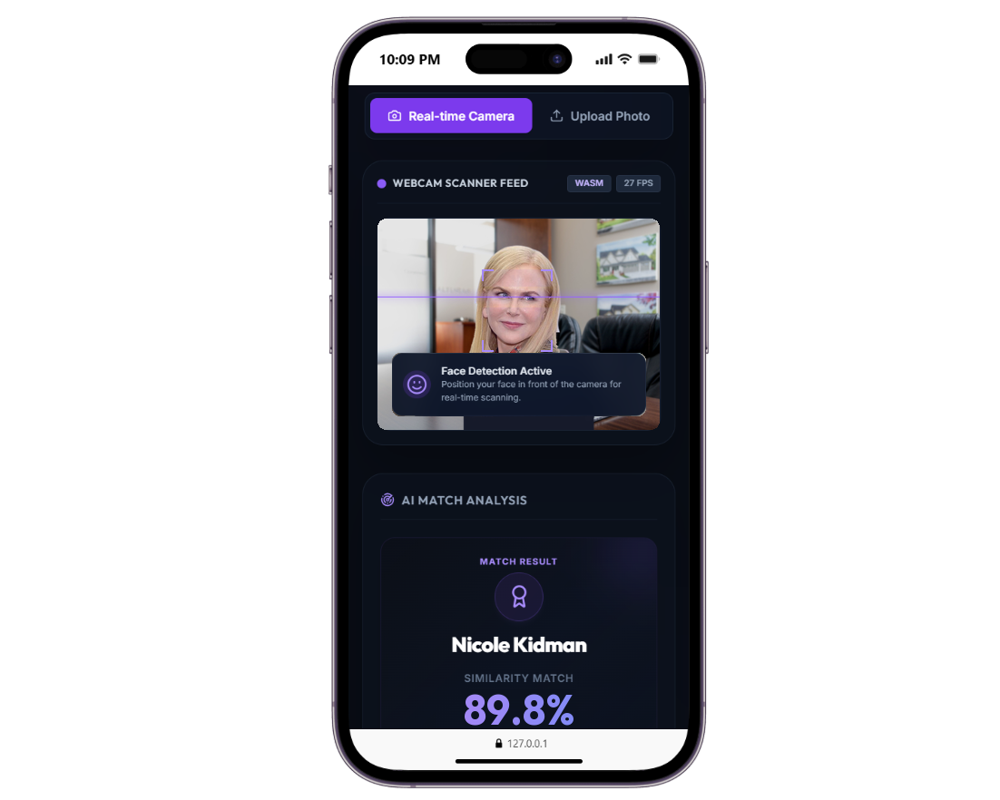
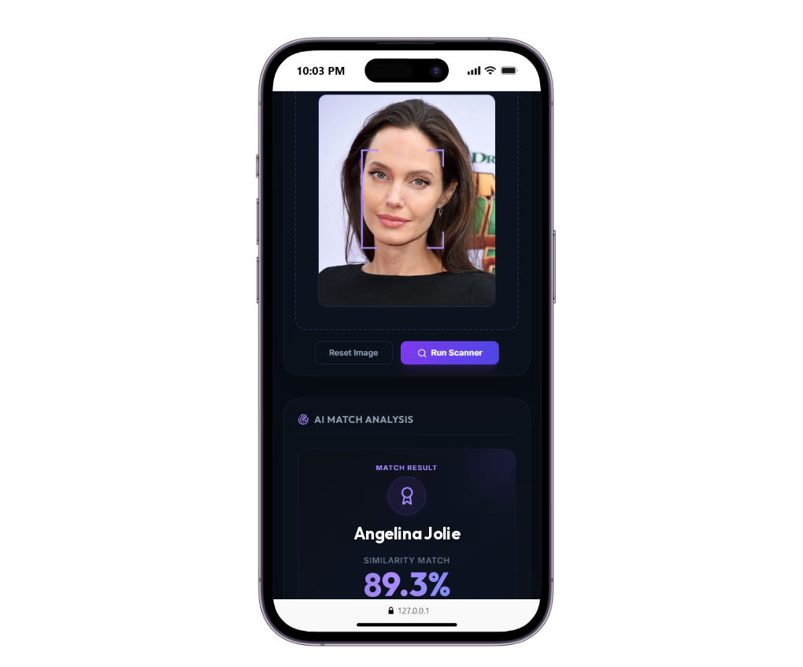
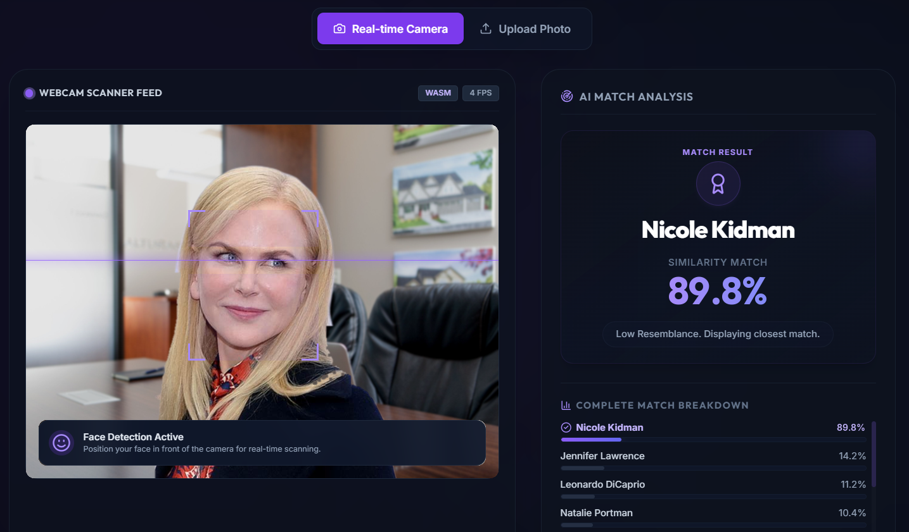
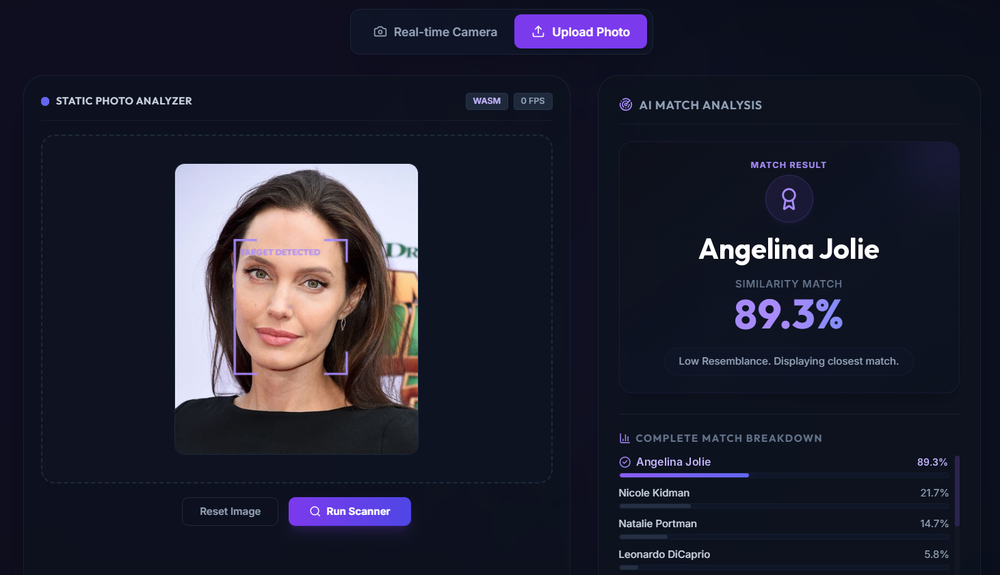

# CelebMatch AI

CelebMatch AI is a client-side celebrity lookalike demo. Choose live scanning with a camera or select a photo to compare it with the celebrity classes supported by the included model. The web app runs inference in the browser, and the Flutter app runs inference on the device; neither client requires an application backend.

## Screenshots

All screenshots use the same display dimensions.

### Mobile Application

#### Live Scan



#### Photo Upload



### Web Application

#### Live Scan



#### Photo Upload



## Features

- Start scanning from the front-facing camera when the app opens.
- Switch between real-time camera scanning and photo upload.
- View the closest celebrity match and a confidence breakdown.
- Run inference locally with TensorFlow Lite in Mobile or ONNX Runtime Web in the browser.
- Keep photos on the client device; the app does not send them to a project backend.

## System Overview

```text
Mobile Application                 Web Application
       │                                   │
       ├── Camera or selected photo        ├── Camera or selected photo
       │                                   │
       ▼                                   ▼
 TensorFlow Lite model                ONNX model
 (on device)                           (in browser)
       │                                   │
       └──────────── Local inference ──────┘
```

## Tech Stack

| Component | Technology | Purpose |
|---|---|---|
| Mobile client | Flutter, Dart | Camera scanning and photo upload |
| Flutter inference | TensorFlow Lite (`tflite_flutter`) | On-device image classification |
| Web client | HTML, JavaScript, Tailwind CSS | Browser-based scanner interface |
| Web inference | ONNX Runtime Web, TensorFlow.js, BlazeFace | Model inference and face detection |
| Image processing | `image` (Dart) | Prepare images for the Flutter model |

## Project Structure

```text
celeb/
├── docs/
│   └── screenshots/              # README screenshots
├── frontend/
│   ├── flutter/
│   │   ├── lib/main.dart         # Flutter application
│   │   ├── assets/               # TFLite model and labels
│   │   └── pubspec.yaml          # Flutter dependencies
│   └── web/
│       ├── index.html            # Web application
│       ├── cnn_label_index.txt   # Class labels
│       └── cnn_celeb.onnx        # Required web model (not tracked by Git)
└── README.md
```

## Requirements

- Flutter SDK with a Dart version satisfying the constraint in `frontend/flutter/pubspec.yaml`
- A supported camera device and permission for live scanning
- A browser with camera support for web live scanning
- Internet access when running the web app, to load its CDN-hosted libraries and models
- The `cnn_celeb.onnx` model file in `frontend/web/` to run web inference. Model files with the `.onnx` extension are excluded from this repository and must be provided separately.

## Setup and Run

### Mobile

From the repository root:

```bash
cd frontend/flutter
flutter pub get
flutter run
```

The Flutter model (`assets/cnn_celeb.tflite`) and label index are included in the project. Allow camera access to use live scanning. Select **Upload Photo** to choose an image instead.

Run the Flutter checks with:

```bash
flutter analyze
flutter test
```

### Web

Make sure `cnn_celeb.onnx` is available in `frontend/web/` alongside `index.html` and `cnn_label_index.txt`. From the repository root, start a local static server:

```bash
cd frontend/web
python -m http.server 8080
```

Open [http://localhost:8080](http://localhost:8080) in a browser. Use **Real-time Camera** for live scanning or **Upload Photo** to select an image. Camera access generally requires a secure context, such as `localhost` or HTTPS.

## Notes

- The results are model predictions for the closest class, not a verified identification or a measure of objective resemblance.
- The project does not include or require an API server for image classification.
